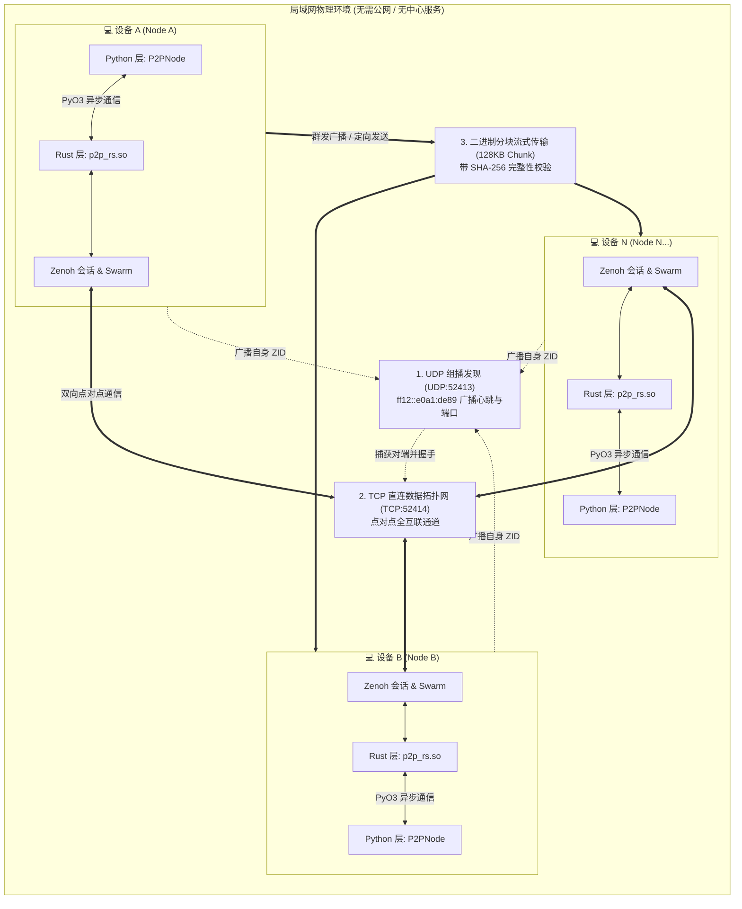

<div align="center">

# 🌐 P2P Network (分布式对等网络与文件传输引擎)

**从 [exo](https://github.com/exo-explore/exo) 深度解耦并独立演进的高性能轻量级局域网 P2P 组网与大文件分发模块**

[](https://www.rust-lang.org/)
[](https://www.python.org/)
[](https://zenoh.io/)
[-blue)](https://pyo3.rs/)
[](LICENSE)

<p align="center">
  <a href="#-核心特性">核心特性</a> •
  <a href="#-系统架构">系统架构</a> •
  <a href="#-快速开始">快速开始</a> •
  <a href="#-命令行交互指南">交互指南</a> •
  <a href="#-python-api-集成">Python API</a> •
  <a href="#-网络与端口规范">网络规范</a> •
  <a href="#-常见问题-faq">常见排查</a>
</p>

</div>

---

## 🚀 核心特性

| 特性 | 技术实现 | 优势说明 |
| :--- | :--- | :--- |
| **🔍 零配置自动发现** | IPv6 链路本地组播 (`ff12::e0a1:de89`) | 无需任何中心服务器、中继节点或配置 IP，局域网设备通电自组网 |
| **💓 节点动态生命周期感知** | Zenoh Liveliness Token 拓扑心跳 | 秒级感知局域网内任意新设备的加入 (`join`) 与离线/断网退出 (`leave`) |
| **📦 高速可靠大文件分发** | 128KB 动态流式分块 + SHA-256 校验 | 专为 `.deb`、`.tar`、`.bin` 等大型二进制安装包与模型权重分发设计 |
| **📢 广播与定向双模式** | Pub/Sub 主题过滤 + 目标 ID 过滤 | 支持向局域网**所有机器一键群发**，或向**某台指定机器定向单播** |
| **⚡ 跨 Python 版本兼容** | PEP 384 Stable C-API (`abi3-py310`) | 一次编译，无缝跨 Python 3.10 / 3.11 / 3.12 / 3.13 / 3.14+ 运行，零段错误 |
| **🛡️ 纯净解耦与轻量化** | 剥离原 exo 的 storage 冗余插件 | 纯原生 Rust 异步驱动，内存占用极低，启动时间小于 0.2 秒 |

---

## 🏛 系统架构



---

## 📂 项目结构

```text
my_p2p_network/
├── Cargo.toml               # Rust 工作区配置（定义依赖与 patch 分支）
├── Cargo.lock               # 依赖版本锁定文件
├── build.sh                 # 【一键构建脚本】调用 cargo 编译并输出 Python 动态库
├── run_node.py              # 【交互式命令行程序】提供节点查询、群发/单发文件、广播消息等
├── test_p2p.py              # 自动化双节点联调测试用例
├── rust/
│   ├── networking/          # 纯 Rust 底层网络协议栈
│   │   ├── Cargo.toml
│   │   └── src/
│   │       ├── discovery.rs # IPv6 UDP 组播收发与物理网卡监听
│   │       ├── swarm.rs     # Zenoh 拓扑、主题订阅与存活(Liveliness)事件流
│   │       └── lib.rs       # 会话初始化与运行时生命周期管理
│   └── p2p_rs/              # PyO3 Python 原生 C 扩展封装层
│       ├── Cargo.toml       # 声明 abi3-py310 Stable ABI 支持
│       └── src/
│           ├── networking.rs# NetworkingHandle 与 FromSwarm 异步桥接
│           └── lib.rs       # Python 模块入口 (p2p_rs)
└── python/
    └── p2p_network/         # 高级 Python 面向对象 SDK
        ├── __init__.py      # 模块导出入口
        ├── node.py          # P2PNode 核心节点管理器（事件回调与生命周期）
        ├── file_transfer.py # 分块流式传输管理器（SHA-256 哈希校验）
        └── p2p_rs.so        # 编译产物（由 build.sh 生成并自动放入此目录）
```

---

## 🛠️ 快速开始

### 1. 环境准备 (全新 Linux 机器)

在干净的 Ubuntu / Debian 机器上执行：

```bash
# 1. 安装基础开发库
sudo apt-get update
sudo apt-get install -y build-essential cmake pkg-config libssl-dev clang git python3 python3-pip

# 2. 安装 Rust 工具链 (若已有可跳过)
curl --proto '=https' --tlsv1.2 -sSf https://sh.rustup.rs | sh
source "$HOME/.cargo/env"
```

### 2. 一键编译

进入项目根目录，直接运行编译脚本：

```bash
cd my_p2p_network
chmod +x build.sh
./build.sh
```

> [!TIP]
> 编译输出已完全实现 **0 报错、0 警告**，编译产物 `p2p_rs.so` 会自动复制到 `python/p2p_network/` 目录下。

### 3. 运行节点

```bash
python3 run_node.py
```

终端将打印节点在线信息与操作提示：
```text
09:32:53 [INFO] 🚀 Starting P2P Node [ID: 96dbf3f6223f760e] namespace='my_p2p_network' listen_port=52414 discovery_port=52413
09:32:54 [INFO] ✅ Node '96dbf3f6223f760e' is now online and discovering peers.

============================================================
🌐 P2P Node Online: 96dbf3f6223f760e
   Namespace:       my_p2p_network
   Listen Port:     TCP 52414
   Discovery Port:  UDP 52413
   Download Folder: /path/to/my_p2p_network/downloads
============================================================

Interactive Commands:
  nodes                        - Show active nodes in cluster
  send <file_path>             - Broadcast file (.deb, .tar, etc.) to ALL nodes
  send <file_path> <peer_id>   - Send file ONLY to a specific node
  msg <text>                   - Broadcast a message on 'chat' topic
  quit / exit                  - Exit node

p2p> 
```

---

## 💻 命令行交互指南

| 指令 | 语法 | 功能描述 |
| :--- | :--- | :--- |
| **查看集群节点** | `nodes` | 列出局域网内当前所有在线的其他设备 ID 与在线总数 |
| **群发广播文件** | `send <file_path>` | 将指定文件（`.deb`、`.tar` 等）**同时群发到网络中所有设备** |
| **定向单播文件** | `send <file_path> <peer_id>` | 仅将文件发送给指定 ID 的设备，其他设备自动过滤忽略 |
| **广播即时消息** | `msg <text>` | 在集群全局聊天频道广播一行文本消息 |
| **优雅退出** | `quit` 或 `exit` | 广播下线通知并释放所有网络端口，平稳退出 |

### 交互实战演示

#### 场景 1：动态发现其他设备上线
当你在局域网第二台电脑启动节点时，第一台电脑会**秒级自动打印通知**：
```text
🔔 [CLUSTER UPDATE] New device connected: 1ab7a65a852fafe7
📊 Current active devices (1): ['1ab7a65a852fafe7']
```

#### 场景 2：分发 `.deb` 安装包
```text
p2p> send /data/packages/app_v1.0.0_amd64.deb
```
- **发送方输出**：
  ```text
  Computing SHA-256 for 'app_v1.0.0_amd64.deb' (45.20 MB)...
  🚀 [Sending File] 'app_v1.0.0_amd64.deb' (45.20 MB) in 362 chunks
  📤 [Uploading] 'app_v1.0.0_amd64.deb': 181/362 chunks (50.0%)
  ✨ [File Sent Finished] 'app_v1.0.0_amd64.deb' (47395840 bytes)
  ```
- **所有接收方输出**：
  ```text
  📥 [Incoming File] 'app_v1.0.0_amd64.deb' (45.20 MB) from node '96dbf3f6223f760e'. Total chunks: 362
  ⏳ [Downloading] 'app_v1.0.0_amd64.deb': 181/362 chunks (50.0%)
  ✅ [File Received Successfully] 'app_v1.0.0_amd64.deb' (45.20 MB, 68.32 MB/s) saved to ./downloads/app_v1.0.0_amd64.deb
  🎉 [File Saved] 'app_v1.0.0_amd64.deb' (47395840 bytes)
     Saved to: /home/user/my_p2p_network/downloads/app_v1.0.0_amd64.deb
     SHA256:   d41d8cd98f00b204e9800998ecf8427e997e3a6a9b934ca495991b7852b855
  ```

#### 场景 3：设备断电或退出感知
当某台机器退出（`quit`）或物理断网时，其他节点会自动感知：
```text
⚠️  [CLUSTER UPDATE] Device disconnected: 1ab7a65a852fafe7
📊 Remaining active devices (0): []
```

---

## 🐍 Python API 集成

你可以将 `python/p2p_network` 作为独立包直接导入你的商业/业务项目：

```python
import asyncio
from p2p_network import P2PNode

async def main():
    # 1. 实例化节点
    node = P2PNode(
        namespace="fleet_cluster", # 命名空间（相同 namespace 的节点互通）
        listen_port=52414,         # TCP 监听端口
        discovery_port=52413,      # UDP 组播端口
        download_dir="./downloads" # 文件接收保存路径
    )

    # 2. 注册设备状态回调
    node.on_peer_join = lambda peer: print(f"🟢 节点加入: {peer}")
    node.on_peer_leave = lambda peer: print(f"🔴 节点断开: {peer}")

    # 3. 注册文件接收完毕回调
    def handle_received_file(info: dict):
        print(f"📦 文件接收成功: {info['filename']}")
        print(f"   存储路径: {info['saved_to']}")
        print(f"   文件大小: {info['file_size']} bytes")
        print(f"   传输耗时: {info['elapsed_seconds']}s (均速: {info['speed_mbps']} MB/s)")
        print(f"   SHA-256:  {info['sha256']}")
    node.on_file_received = handle_received_file

    # 4. 启动节点服务
    await node.start()

    # 5. 向所有节点群发 deb 包（留空 target_peer 为广播）
    await node.send_file("/opt/package.deb")

    # 6. 向指定节点定向发送 tar 包
    # await node.send_file("/opt/dataset.tar", target_peer="1ab7a65a852fafe7")

    # 保持主协程常驻
    while True:
        await asyncio.sleep(1)

if __name__ == "__main__":
    asyncio.run(main())
```

---

## 📡 网络与端口规范

在部署集群与防火墙配置时，请确保以下端口策略：

| 协议 | 端口号 | 方向 | 作用与机制 |
| :--- | :--- | :--- | :--- |
| **UDP** | `52413` | 双向 | 链路本地组播发现（IPv6: `ff12::e0a1:de89`），周期广播节点存活 |
| **TCP** | `52414` | 双向 | 节点间点对点数据传输直连链路（消息、文件分块流传输） |

在 Ubuntu 上放行端口（如果开启了 `ufw`）：
```bash
sudo ufw allow 52413/udp
sudo ufw allow 52414/tcp
```

---

## ❓ 常见问题 (FAQ)

<details>
<summary><b>1. 两台机器连接同一 Wi-Fi，但 nodes 显示 0，无法发现彼此？</b></summary>

- **原因 1（Wi-Fi 隔离）**：公司访客 Wi-Fi、公共商用 Wi-Fi 通常默认开启了 **AP 隔离 (Client Isolation)**，禁止两台终端内网互相通信。**解决方法**：使用手机开启热点，将两台电脑连接到同一手机热点下测试，即可秒级互联。
- **原因 2（防火墙阻拦）**：系统防火墙可能屏蔽了 52413 UDP。测试可临时关闭防火墙 `sudo ufw disable` 确认。
- **原因 3（IPv6 支持）**：本网络采用 IPv6 Link-Local 组播，请确保网卡未被彻底禁用 IPv6（运行 `ip -6 addr` 能看到 `fe80::` 地址即可）。
</details>

<details>
<summary><b>2. 如果只想在单台机器上测试双节点互通怎么办？</b></summary>

在一个终端启动节点 A：
```bash
python3 run_node.py
```
在另一个新终端启动节点 B（修改 TCP 端口避免端口抢占冲突）：
```bash
python3 run_node.py --port 52415
```
此时两边就会立即检测到彼此，并在终端输出 `🔔 [CLUSTER UPDATE] New device connected`！
</details>

<details>
<summary><b>3. 传输大文件时若发生丢包，文件会被污染吗？</b></summary>

绝对不会。本系统在传输前由发送方计算全量 **SHA-256 哈希**，接收方写入 `.part` 临时文件。下载完毕后对全量数据严格复算哈希校验，只有哈希 100% 一致才会原子重命名为正式文件。若哈希不符会立即自动丢弃并报错，保证写入磁盘的包绝对可用。
</details>

---

<div align="center">
  <sub>Developed & Decoupled with ❤️ for High Performance Edge & LAN Computing</sub>
</div>
